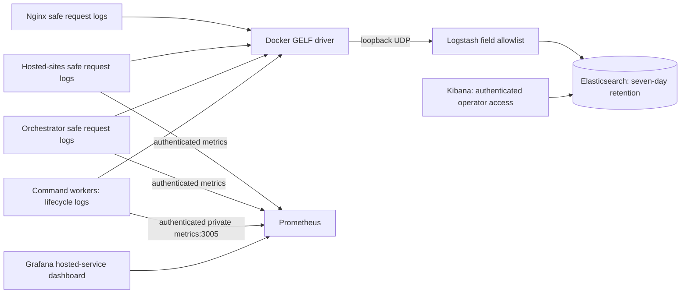

# Observability

The optional stack includes ELK for safe request and lifecycle logs and
Prometheus/Grafana for HTTP, worker, queue, callback and process metrics.
All operator interfaces remain local to the host.

## Optional ELK stack

`infra/docker/docker-compose.elk.yml` runs Elasticsearch, Logstash and Kibana
as an independent Compose project. The application does not depend on its
availability. Elasticsearch is a single-node operational search store, not a
benchmark source of truth or a replacement for the command DLQ and callback outbox.



All Elastic images use the same pinned version. Elasticsearch has a 512 MiB
heap and 1.5 GiB container limit; Logstash has a 256 MiB heap, 768 MiB limit and
256 MiB persistent queue; Kibana has a 1 GiB limit. Prometheus and Grafana each
have a 512 MiB limit. Reserve roughly 5 GiB of
additional host memory plus disk headroom before enabling the stack. These
limits are a starting configuration, not a measured throughput guarantee.

## Provisioning

Prepare a protected environment file based on
`infra/docker/.env.elk.example`. Generate six independent secrets with
`openssl rand -hex 32` and set its permissions to `600`. Do not commit it.

| Setting | Development | Production |
| --- | --- | --- |
| `ELK_PROJECT_NAME` | `agentbench-development-elk` | `agentbench-production-elk` |
| `DEPLOYMENT_ENVIRONMENT` | `development` | `production` |
| `ELK_GELF_PORT` | `12202` | `12201` |
| `ELK_KIBANA_PORT` | `5602` | `5601` |
| `ELK_GRAFANA_PORT` | `3302` | `3300` |
| `ELK_RUNTIME_NETWORK` | `agentbench-local-development_default` | `agentbench-single-vm_default` |

Use different credentials in each environment. Project names isolate volumes
and networks; ports must also be distinct. On the Linux host, configure
`vm.max_map_count=262144` or higher before startup.

```bash
docker compose --env-file /protected/development-elk.env \
  -f infra/docker/docker-compose.elk.yml up -d
docker compose --env-file /protected/development-elk.env \
  -f infra/docker/docker-compose.elk.yml logs --tail=50 elk-setup logstash
```

Setup waits for Elasticsearch, provisions separate Kibana and Logstash users,
and installs the index template and seven-day ILM deletion policy. Failure
prevents Logstash and Kibana startup. Elasticsearch exposes no host port.
Kibana, Grafana and GELF bind only to loopback. HTTP between Elastic services runs on an
isolated internal Docker network; this configuration is for one trusted host,
not an untrusted network or a multi-host cluster.
The UI/ingest services also join a bridge network so Docker can publish their
loopback listeners; Elasticsearch does not join it. Prometheus alone joins
the matching application's external Compose network to scrape its services.
Start the application project first so that network exists.

Merge `docker-compose.elk-logging.yml` after the application Compose file to
enable ingestion. Use the same GELF port as the selected ELK environment:

```bash
docker compose --env-file /protected/development-runtime.env \
  --env-file /protected/development-elk.env \
  -f infra/docker/docker-compose.single-vm.yml \
  -f infra/docker/docker-compose.elk-logging.yml up -d
```

The override also works with `docker-compose.server.yml`. Changing the logging
driver recreates application containers, so schedule activation appropriately.
To persist activation through single-VM CD, set `ELK_ENV_FILE` in the protected
runtime environment file to the absolute path of the protected ELK file. The
deployment script validates the ELK project, environment and ports, provisions
the separate stack and includes the logging override on every deployment.
Development CD also runs ingestion and authenticated scrape smoke tests. Leave `ELK_ENV_FILE`
unset to disable activation. The stack does not collect Vercel logs
or Web logs yet. Workers' legacy console errors remain available in Docker's
bounded local cache but are excluded from Elasticsearch.

## Access and search

Reach development Kibana through an SSH forward:

```bash
ssh -L 5602:127.0.0.1:5602 operator@host
```

Open `http://localhost:5602`. Use the `elastic` account only for initial
administration. Create named operator users with the `agentbench_log_reader`
role; it grants read access to `agentbench-logs-*` and the default Kibana space.
The one-shot `kibana-setup` service provisions the `agentbench-logs` data view
using `@timestamp` and four saved Discover searches: Command Lifecycle, Retries
and Failures, Callback Delivery, and Workers and Collectors. Setup waits for
Kibana readiness and overwrites only its own stable object IDs. Existing
operator searches are preserved. Check its exit status after deployment;
failure does not stop benchmark services.
Do not publish Kibana or the ingest port through Cloudflare Tunnel.

Useful Discover filters include `service: gateway AND status >= 500` and
`request_id: "<request-id>"`. Gateway request IDs propagate to hosted services;
direct requests receive a new UUID. Timing is normalized to milliseconds.
Lifecycle events can be filtered by `command_id`, `run_id`, `attempt_id` and
`session_id`. These are validated UUIDs, never authorization tokens. No raw
exception messages or task payloads are indexed.

## Prometheus and Grafana

Forward development Grafana with `ssh -L 3302:127.0.0.1:3302 operator@host`,
then open `http://localhost:3302`. Initial login is `admin` with the independently
generated `GRAFANA_ADMIN_PASSWORD`. Anonymous access and self-registration are
disabled. Add named users and reserve the administrator account for operations.
The Prometheus datasource and AgentBench Hosted Services dashboard are provisioned
from source, including scrape health, requests/second, 5xx rate, p95/p99 request
latency and process resident memory. Low traffic needs enough observations before
rate/quantile panels have useful data.

Prometheus exposes no host port. It scrapes API-mode orchestrator and hosted-sites
every 15 seconds using a dedicated `HOSTED_METRICS_TOKEN`, not the privileged
internal service secret. `/metrics` is disabled without opt-in, requires that
bearer token, and is blocked at Nginx. Labels contain only service, coarse route
and status class. Request IDs, run/session IDs, URLs and private payloads are not
metric labels. Scrapes do not inflate request counters. Counters reset on process
restart; this is expected for Prometheus rate calculations.

Prometheus retains seven days or 2 GB of samples, whichever limit is reached
first; allow additional WAL and compaction space. Grafana and Prometheus have
independent persistent volumes. Worker queue/partition metrics, database/Redis
exporters and host metrics are separate from the application diagnostics below.

### Orchestrator diagnostics

The AgentBench Orchestrator Operations dashboard adds:

- Worker scrape health and partition lease ownership.
- Pending entries, known stream lag, and oldest pending age per partition.
- Command throughput, processing p95/p99, retries, reclaims and dead letters.
- Callback backlog, oldest age, delivery latency, retries and terminal failures.
- Active attempts/sessions and retained durable dead-letter count.
- Per-process PostgreSQL pool total, idle, maximum and waiting connections.
- Process CPU, heap usage and event-loop p99.
- Collector health and snapshot age.

API mode samples Redis every 15 seconds and one read-only PostgreSQL aggregate
every 60 seconds. Scrapes read cached diagnostics and local pool statistics;
they do not execute SQL or Redis commands. Workers expose an authenticated
metrics-only listener on internal port 3005 (overridable with
`HOSTED_ORCHESTRATOR_METRICS_PORT` for isolated local checks); it has no health or lifecycle
routes and is not published through the gateway. API and workers share the
dedicated metrics token. Instance labels distinguish their process metrics.

Redis pending age is measured from the oldest pending stream entry's creation
timestamp, not its last claim. Unknown stream lag is marked with
`command_lag_known=0`, not interpreted as zero. Failed collectors retain the
last successful values, mark themselves unavailable, and expose increasing
snapshot age. Check health/freshness before interpreting queue counts.
Callback delivery duration measures a single delivery attempt, not total
time in the outbox; the oldest-age gauge measures backlog age.

Prometheus loads rules for scrape failure, missing worker leases, stalled
commands/callbacks, pool waiting, collector failure/staleness, and new dead
letters. They are visible in Prometheus and Grafana's Prometheus datasource.
No Alertmanager or external notification destination is configured. These
thresholds are initial operational defaults, not throughput guarantees.
Host/disk metrics, full database/Redis exporters and distributed tracing remain
future work.

## Privacy and retention

Only structured `http.request` and enumerated operational records are accepted.
The Logstash filter
creates a fresh event containing timestamp, environment, service, request ID,
HTTP method, coarse route category, status and duration. Each string field is
validated against a bounded format or enumeration. Query strings, IPs, URLs,
headers, tokens, bodies, exception text, evaluator inputs and arbitrary nested
JSON are never indexed. Unstructured logs are intentionally dropped rather
than relying on regex-based credential redaction. Logstash startup executes
embedded filter tests and fails if privacy or timing checks fail.
Operational fields are restricted to event, role, command type, UUID correlation
IDs, partition, status, duration and collector source. Counters and histograms
use bounded event/type labels; correlation IDs never become metric labels.
Telemetry failures cannot change command acknowledgement or callback delivery.

UDP and non-blocking Docker logging can lose events during downtime or overload.
The Logstash queue only protects events received by Logstash. This is diagnostic
logging, not an audit trail. Daily single-shard indices are deleted by ILM seven
days after index creation, subject to ILM polling; retention is not a hard disk
quota. Monitor disk capacity and HTTP 429/index write failures. Avoid adding
arbitrary payloads to the safe schema to diagnose an incident.

## Verification and rollback

`scripts/test-elk-config.sh`, included in `pnpm verify:ci`, validates credentials
being required, private bindings, project isolation and non-blocking transport.
Hosted-sites unit tests cover request privacy, timing and correlation.
On a Docker host, run `tests/e2e/elk-smoke.sh /protected/development-elk.env`
after startup to verify ingestion, normalization and rejection of private data.
Run `bash tests/e2e/metrics-smoke.sh <test-env-file>` to require all four hosted
Prometheus targets to be healthy after application deployment.
Verify `kibana-setup` exited successfully and open both provisioned Grafana
dashboards and a saved Discover search. Setup updates strict mappings on existing
log indices as well as the template, so today's index accepts lifecycle fields.
Then make a real development hosted request and check the corresponding gateway
and service records. Do not use production lifecycle traffic for this check.

Remove the logging override and recreate the application services to disable
ingestion. Stop the separate ELK project without `--volumes` to preserve stored
logs. Neither activation nor rollback changes PostgreSQL or Redis lifecycle
state. Rotate the Logstash/Kibana passwords by updating the protected file,
rerunning `elk-setup`, and recreating their containers. Changing
`ELASTIC_PASSWORD` alone does not rotate an existing Elasticsearch superuser;
use its password-change API first and then update the file.

The transport uses Docker's [GELF driver](https://docs.docker.com/engine/logging/drivers/gelf/)
and Elastic's [GELF input](https://www.elastic.co/docs/reference/logstash/plugins/plugins-inputs-gelf).
See [Elastic Docker installation](https://www.elastic.co/guide/en/elasticsearch/reference/8.19/docker.html)
for host requirements and image upgrades.
